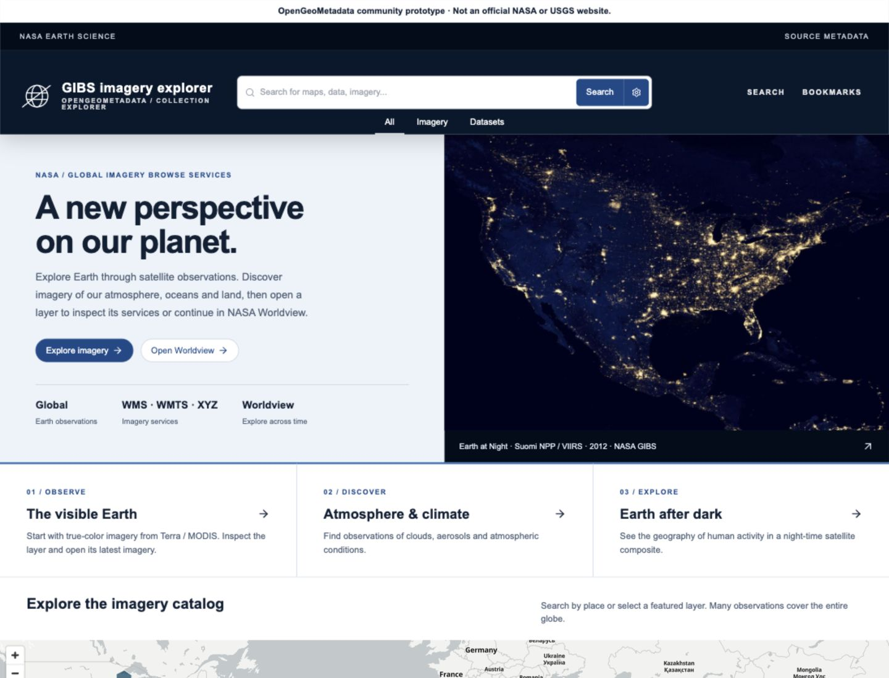
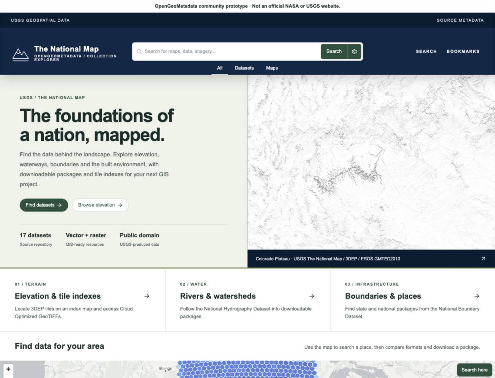
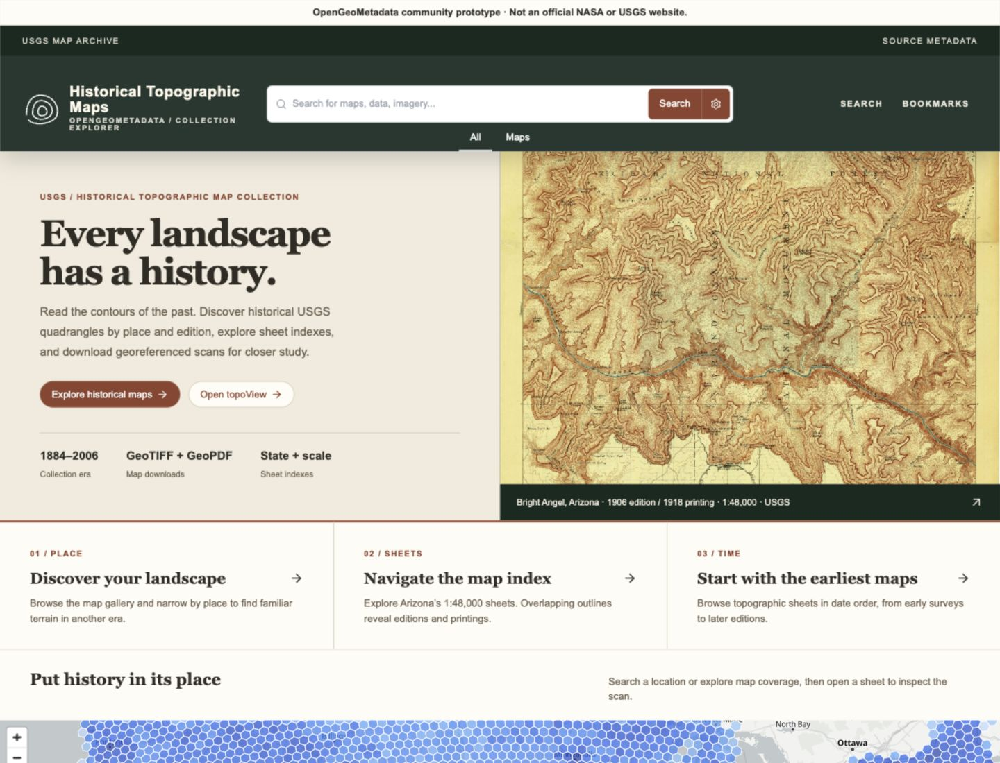
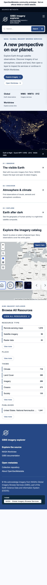
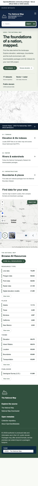
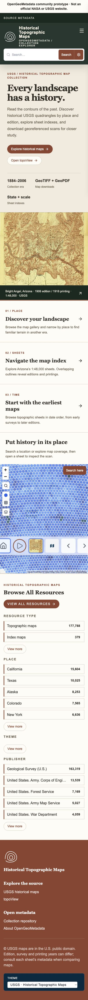

# Federal collection prototypes

The collection homes retain standard discovery alongside [asset-specific research workspaces](federal-research-pathways.md), with a visible switch between both pathways.
This document records the initial branding/source review; its original landing-page
screenshots remain useful for reviewing `#/about-collection`. Current workflow
screenshots are in `screenshots/research-pathways/`.

Reviewed November 4, 2026. These are OpenGeoMetadata community interfaces, not
agency websites. All three use the existing API, record viewer, search and map
components. No metadata mirror, proxy, dependency or agency-specific component
branch is introduced.

## Source and asset review

### NASA Global Imagery Browse Services

Reviewed the [repository README](https://github.com/OpenGeoMetadata/gov.nasa.gibs),
Terra/MODIS true-color and VIIRS city-lights Aardvark records, their service
references, [Worldview](https://worldview.earthdata.nasa.gov/) in the browser, and
[GIBS documentation](https://nasa-gibs.github.io/gibs-api-docs/).

The repository builds one record per visualization layer from capabilities,
layer metadata, Worldview configuration and CMR. These are visualization services,
not a uniform collection of downloadable source datasets. Raster layers can link
XYZ, WMTS and WMS; vectors use geographic WMS; polar-only layers may have no
compatible Web Mercator preview. Default imagery dates can be partly filled.
Worldview is the appropriate destination for time exploration.

Worldview's dark controls and image-dominated map informed the navy header,
blue accents and night-imagery introduction. The pathways lead to an actual
true-color record, the exact `Climate` facet, and a 2012 night-time composite.
The still image is explicitly dated; it is not advertised as a live observation.

### USGS The National Map

Reviewed the [repository README](https://github.com/OpenGeoMetadata/gov.usgs.tnm),
Iowa NHD package, Iowa 3DEP tile, 1/3 arc-second index record and GeoJSON, and
[The National Map website](https://www.usgs.gov/programs/national-geospatial-program/national-map)
in the browser. Its navy federal header, white reading surfaces and green program
accents informed the palette.

The repository organizes 17 datasets into packages, with multiple downloads on
one record. The inspected NHD package has GeoPackage, geodatabase and shapefile
ZIPs plus FGDC metadata and an ArcGIS dynamic map service. Services display more
than a package footprint. Elevation tiles link directly to COGs. The inspected
DEM index contains 1,449 polygon features with `recId`, `download`, `thumbUrl`
and `websiteUrl`; its internal record route is the tile-discovery entry point.
Combined vector packages and some other datasets have no service preview.

The terrain image comes from the official USGS shaded-relief service, not the
Iowa tile. Its caption identifies the Colorado Plateau and the service credits.
Pathways lead to the elevation index, NHD packages and boundary packages.

### USGS Historical Topographic Map Collection

Reviewed the [repository README](https://github.com/OpenGeoMetadata/gov.usgs.htmc),
Bright Angel 1906 / printed 1918 record and its GeoPDF, the Arizona 1:48,000 index
record and GeoJSON, and [topoView](https://ngmdb.usgs.gov/topoview/) in the browser.
The [USGS collection overview](https://www.usgs.gov/programs/national-geospatial-program/historical-topographic-maps-preserving-past)
is linked from the portal. Automated retrieval of that overview timed out;
topoView and the repository provided the review evidence.

The repository describes scans from the 1884–2006 collection era. The sample
sheet links a COG, GeoTIFF/GeoPDF downloads, FGDC metadata, a thumbnail and a
ScienceBase landing page. Edition, survey, revision and printing dates have
different meanings. The Arizona index has 31 map features across 15 sheets;
editions overlap, and `datePub`, `dateSurvey` and `dateReprnt` preserve chronology.

Warm paper, brown contour ink and the source site's editorial serif treatment
informed the historical theme. The featured image retains its edition and print
dates in its caption. Pathways offer the gallery, an actual sheet index and
oldest-first browsing. They reuse the record viewer; this PR does not implement
a separate time slider or comparison engine.

## Scope and API evidence

Live checks of `https://ogm.geo4lib.app/api/v1/` returned:

| Portal               | Always-on filters                  | Observed count |
| -------------------- | ---------------------------------- | -------------: |
| NASA GIBS            | `pcdm_memberOf_sm=nasa-gibs`       |          1,241 |
| HTMC                 | `pcdm_memberOf_sm=usgs-htmc`       |        177,788 |
| National Map keyword | `dcat_keyword_sm=The National Map` |         91,969 |

Counts are review-time observations, not promises or UI constants. The TNM preset
also restricts `schema_provider_s` to `U.S. Geological Survey`; a provider-only
scope would mix historical maps into this portal. Collection records without
membership are still accessible by direct resource links. TNM uses the existing
keyword/provider contract rather than inventing a repository filter. A future
backend repository facet would provide a more explicit scope if these terms are
reused by additional USGS repositories.

Browser checks confirmed the NHD pathway returns 2,715 packages and theme
selection changes the path and clears the old search. Resource-class caches are
partitioned by theme so switching from NASA to HTMC cannot retain imagery tabs. NASA topic labels come
from the live facet API (`Climate`, not a guessed ISO category name).

## Bundled image provenance

- `earth-at-night.jpg`: NASA GIBS `VIIRS_CityLights_2012`, from the WMS reference in
  [`nasa-gibs-viirs_citylights_2012`](https://github.com/OpenGeoMetadata/gov.nasa.gibs/blob/main/metadata-aardvark/gibs/viirs/nasa-gibs-viirs_citylights_2012.json).
  [WMS request](https://gibs.earthdata.nasa.gov/wms/epsg4326/best/wms.cgi?SERVICE=WMS&REQUEST=GetMap&VERSION=1.1.1&LAYERS=VIIRS_CityLights_2012&STYLES=&SRS=EPSG:4326&BBOX=-130,10,-60,60&WIDTH=1200&HEIGHT=800&FORMAT=image/jpeg).
  Acknowledgement appears in the portal footer and image caption.
- `usgs-shaded-relief.jpg`: public-domain image from
  [USGS Shaded Relief](https://basemap.nationalmap.gov/arcgis/rest/services/USGSShadedReliefOnly/MapServer),
  exported for bounds `-115,34,-109,39`, geographic input / Web Mercator output,
  1,200 × 900 pixels. Credits: USGS The National Map / 3DEP and USGS EROS / GMTED2010.
- `bright-angel-1906.jpg`: rendered from the original public-domain
  [USGS GeoPDF](https://prd-tnm.s3.amazonaws.com/StagedProducts/Maps/HistoricalTopo/PDF/AZ/48000/AZ_Bright%20Angel_314262_1906_48000_geo.pdf),
  linked by [`usgs-htmc-314262`](https://github.com/OpenGeoMetadata/gov.usgs.htmc/blob/main/metadata-aardvark/htmc/314/usgs-htmc-314262.json).
  The introduction crops the sheet photographically; the record links the full map.
- The three SVG collection symbols are original simple line graphics (globe,
  terrain and contours), not official seals or logos.

Bundling keeps the first view independent of third-party thumbnail availability.
Interactive maps and record previews continue to load directly from their service
providers, and remain subject to upstream availability and browser CORS support.

## Review screenshots

Captured from the local application with live API data. Desktop and mobile
screenshots cover each preset; no mock metadata or fabricated result counts.

| NASA GIBS                                                              | The National Map                                                     | Historical Maps                                                        |
| ---------------------------------------------------------------------- | -------------------------------------------------------------------- | ---------------------------------------------------------------------- |
|  |  |  |
|    |    |    |
